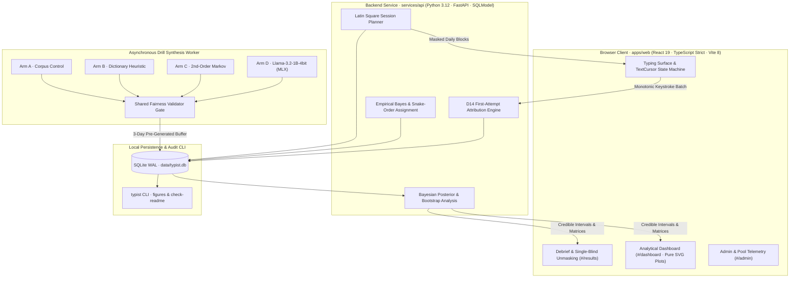
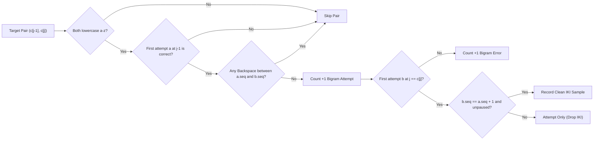
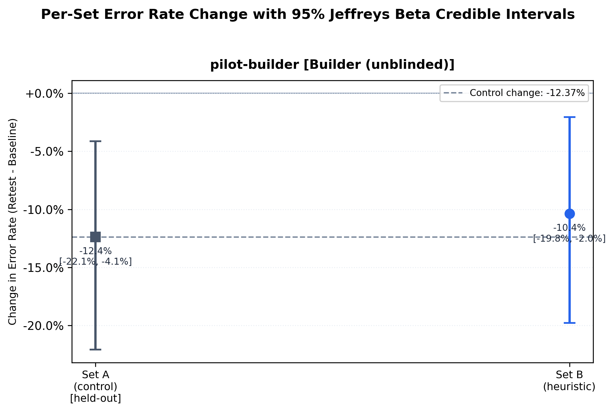
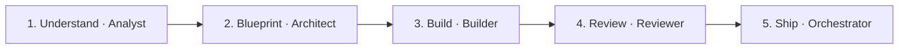

<div align="center">

# Typist-ML

**On-Device Generative AI Typing Coach & Controlled Motor-Learning Experiment**

[](https://github.com/allenvarghese05/typist-ml/actions/workflows/ci.yml)
[](LICENSE)
[](services/api/)
[](apps/web/)
[](https://github.com/ml-explore/mlx)
[](docs/analysis-plan.md)

[Architecture](#system-architecture) · [Keystroke Physics](#keystroke-physics--biomechanical-telemetry) · [Bayesian Assignment](#experimental-protocol--empirical-bayes-assignment) · [Generative Arms](#the-4-generative-drill-arms--trade-offs) · [Statistical Inference](#pre-registered-statistical-inference) · [Pilot Results](#pilot-results) · [Agentic Pipeline](#autonomous-multi-agent-engineering-pipeline) · [Quickstart](#setup--quickstart)

</div>

---

**Typist-ML** is a local-first typing coach engineered from the ground up as a within-subject, single-blind randomized controlled trial (RCT). Rather than treating typing speed as a coarse word-level average, the system captures sub-millisecond hardware keystroke physics, isolates individual character-transition weaknesses via **Empirical Bayes shrinkage**, synthesizes targeted practice drills across four competing generative paradigms (**Control**, **Dictionary Heuristic**, **2nd-Order Markov**, and an **On-Device 1B Quantized LLM** on Apple Silicon Metal/MLX), and evaluates motor-learning transfer under pre-registered **Bayesian difference-in-differences** inference.

Status: milestone 4 (Pilot complete).

Design: [docs/design/Typist-ML_Technical_Design.pdf](docs/design/Typist-ML_Technical_Design.pdf)

Analysis plan (pre-registered): [docs/analysis-plan.md](docs/analysis-plan.md)

| Telemetry Precision | Experimental Scale | Generative Paradigms | Verification & Reproducibility |
| :--- | :--- | :--- | :--- |
| **`0.20 ms` p95** keystroke handler (`< 1.0 ms` SLA) | **`14` sessions** · **`25,022`** recorded keystrokes | **4 arms** gated by an identical fairness validator | **`643` tests** (`164` Web + `479` API) + automated DB claim audit |

- **Interactive Results Notebook:** [`notebooks/03_results.ipynb`](notebooks/03_results.ipynb)
- **Web Routes:** Typing Surface (`#/`) · Visual Analytics Dashboard (`#/dashboard`) · Single-Blind Debrief & Unmasking (`#/results`) · Admin Console (`#/admin`)

---

## System Architecture

Typist-ML is structured as a zero-cloud monorepo. Every keystroke event, model forward pass, SQLite transaction, and posterior Monte Carlo draw executes strictly on-device:



| Layer | Location | Key Engineering Responsibilities |
| :--- | :--- | :--- |
| **Web Client** | [`apps/web`](apps/web/) | Deterministic `TextCursor` state machine, monotonic `event.timeStamp` capture, display-only session feedback, zero-dependency SVG forest/whisker plots, single-blind arm lock until completion. |
| **Telemetry & Attribution** | [`services/api/src/typist/services/attribution.py`](services/api/src/typist/services/attribution.py) | Authoritative bigram attempt, error, dwell, and press-to-press IKI extraction; strict pause/blur exclusion; raw sample pooling across session blocks (never taking a median of medians). |
| **Drill Synthesis & MLX** | [`services/api/src/typist/generation/`](services/api/src/typist/generation/) | Pluggable 4-arm drill generators behind an identical validator (`[0.10, 0.40]` density, character set, coverage, lexical caps) with background buffer replenishment. |
| **Statistical Engine** | [`services/api/src/typist/services/analysis.py`](services/api/src/typist/services/analysis.py) | Jeffreys Beta credible intervals, 100,000-draw Monte Carlo targeting posteriors, 10,000-resample non-parametric IKI bootstraps, headless 300 DPI figure generation, and automated README verification. |

---

## Keystroke Physics & Biomechanical Telemetry

Conventional typing tests score completed words at the end of a timer. Typist-ML models typing as a continuous neuromotor sequence of physical switch depressions $t_{\mathrm{down}}(j)$ and releases $t_{\mathrm{up}}(j)$ across adjacent lowercase letter pairs (bigrams $b = c_{j-1}c_j$).

```text
         t_down(j-1)         t_up(j-1)          t_down(j)          t_up(j)
              │                  │                  │                 │
              ▼                  ▼                  ▼                 ▼
Timeline ─────●══════════════════●──────────────────●═════════════════●─────►
              │◄── Dwell(j-1) ──►│                  │◄─── Dwell(j) ──►│
              │                                     │
              │◄────── Press-to-Press IKI(j) ──────►│
```

### 1. Physical Switch Dwell Duration

Dwell time measures the mechanical hold duration of a single key switch from initial actuation to release:

$$
\mathrm{Dwell}_j = t_{\mathrm{up}}(j) - t_{\mathrm{down}}(j)
$$

- **Telemetry handling:** Recorded as an append-only update to `keystroke_events` when the matching `keyup` arrives, capturing finger hold tension without blocking the `keydown` hot path.

### 2. Press-to-Press Inter-Key Interval (IKI) & Rollover Physics

Transition latency between consecutive characters $c_{j-1} \to c_j$ is defined strictly **press-to-press** using monotonic high-resolution timestamps:

$$
\mathrm{IKI}_j = t_{\mathrm{down}}(j) - t_{\mathrm{down}}(j - 1)
$$

Fast touch-typists routinely overlap keystrokes (**rollover typing**), initiating the downward strike of key $j$ before key $j - 1$ has physically released:

$$
t_{\mathrm{down}}(j) \lt t_{\mathrm{up}}(j - 1) \implies t_{\mathrm{down}}(j) - t_{\mathrm{up}}(j - 1) \lt 0
$$

Measuring release-to-press flight time produces negative intervals under rollover, whereas press-to-press $\mathrm{IKI}_j$ remains strictly positive and directly reflects motor-program execution between consecutive finger strikes.

### 3. Pause & Attentional Disruption Filtering (D24, D23a)

Looking away from the screen, window focus loss (`blur`), or mid-sentence hesitation injects multi-second delays unrelated to finger transition speed. Under pre-registered rules **D24** and **D23a**, an adjacent clean transition yields a valid timing sample if and only if it belongs to $\mathcal{I}_{\mathrm{clean}}$:

$$
\mathcal{I}_{\mathrm{clean}} = \left\{\, \mathrm{IKI}_j \;\middle|\; 0\,\mathrm{ms} \lt \mathrm{IKI}_j \le 2000\,\mathrm{ms} \;\land\; \neg\,\mathrm{paused}(j) \,\right\}
$$

- **Strict threshold (D24):** Gaps strictly exceeding $2000\,\mathrm{ms}$ ($\mathrm{IKI}_j \gt 2000\,\mathrm{ms}$) or carrying `after_pause = true` (focus blur / resume) are classified as cognitive pauses; a gap of exactly $2000\,\mathrm{ms}$ is retained.
- **No denominator distortion (D23a):** Paused pairs still count toward bigram **attempts** (and **errors** if mistyped); only the contaminated **IKI timing sample** is dropped.

### 4. Session Net Typing Speed & First-Attempt Accuracy (D26)

Session speed and accuracy pool raw counts across all $B$ blocks in a session (excluding idle inter-block rest screens) using the standard 5-character word convention:

$$
\mathrm{WPM} = \frac{\left(\sum_{m=1}^{B} C_m\right) / 5}{\left(\sum_{m=1}^{B} \Delta T_m\right) / 60000}
$$

$$
\mathrm{Accuracy} = \frac{\sum_{m=1}^{B} C_m}{\sum_{m=1}^{B} N_m}
$$

- $C_m$: Correct **first-attempt** characters in block $m$.
- $N_m$: Total **first-attempt** characters in block $m$.
- $\Delta T_m = t_{\mathrm{down}}(\mathrm{last}_m) - t_{\mathrm{down}}(\mathrm{first}_m)$: Active block span in milliseconds.

---

### 5. The D14 First-Attempt Bigram Attribution Engine

When a typist makes a typo, hits `Backspace`, and retypes, naive string diffing corrupts adjacent transitions and inflates sample counts. Typist-ML isolates clean motor transitions via the **D14 First-Attempt Attribution State Machine**:



| Scenario (`target = "the"`) | Keystroke Stream | Attributed to `"th"` | Attributed to `"he"` | Why It Matters |
| :--- | :--- | :--- | :--- | :--- |
| **Clean fluent strike** | `t` → `h` → `e` | `1` attempt, `0` errors, clean IKI | `1` attempt, `0` errors, clean IKI | Baseline ballistic motor transition. |
| **Mistyped `h` (uncorrected)** | `t` → `x` → `e` | `1` attempt, **`1` error**, no IKI | **Skipped** (`a` at `h` was an error) | Prevents blaming `"he"` for a hand displacement that happened on `"th"`. |
| **Mistyped `h`, fixed via Backspace** | `t` → `x` → `⌫` → `h` → `e` | `1` attempt, **`1` error**, no IKI | **Skipped** (`a` first attempt failed) | Retry strokes never double-count `"th"` attempts or fabricate artificial fluency. |

> [!IMPORTANT]
> **Cross-Language Golden Contract:** Bigram attribution runs authoritatively in Python ([`attribution.py`](services/api/src/typist/services/attribution.py)), while [`TextCursor`](apps/web/src/telemetry/TextCursor.ts) tracks live cursor state in TypeScript. Both engines are continuously verified against the shared golden keystroke fixture ([`golden_session.json`](services/api/tests/fixtures/golden_session.json)).

---

## Experimental Protocol & Empirical Bayes Assignment

The study follows a **14-session within-person protocol** designed to separate genuine targeted learning from general typing warm-up, daily fatigue, and regression to the mean:


### 1. Empirical Bayes Beta-Binomial Weakness Discovery

Raw error proportions $\hat{p}_b = k_b / n_b$ are dominated by small-sample noise: a rare bigram like `"qz"` with `1/1` error (`100%`) would outrank a genuinely problematic high-frequency bigram like `"th"` with `15/90` errors (`16.7%`).

After pooling baseline counts across both baseline sessions and filtering to candidate bigrams with $n_b \ge 15$ attempts (**D28**), Typist-ML regularizes each bigram's error rate under a conjugate **Empirical Bayes Beta prior** centered on the participant's global baseline error rate $p_0$ with prior concentration $M = 20$:

$$
\theta_b \sim \mathrm{Beta}(\alpha_0, \beta_0), \qquad \alpha_0 = M p_0, \qquad \beta_0 = M(1 - p_0)
$$

Observing $k_b$ errors in $n_b$ baseline attempts yields the posterior mean weakness score $\hat{\theta}_b$, a precision-weighted shrinkage estimator between individual evidence and the participant's baseline prior:

$$
\hat{\theta}_b = \mathbb{E}[\theta_b \mid k_b, n_b] = \frac{k_b + M p_0}{n_b + M} = \left(\frac{n_b}{n_b + M}\right)\frac{k_b}{n_b} + \left(\frac{M}{n_b + M}\right)p_0
$$

Ties in $\hat{\theta}_b$ are broken deterministically using the candidate's standardized median IKI z-score across all qualifying candidates, followed by lexicographic bigram order:

$$
z_b = \frac{m_b - \mu_m}{\sigma_m}
$$

- $m_b$: Single exact median over raw clean IKI samples re-pooled across both baseline sessions.
- $\mu_m, \sigma_m$: Population mean and standard deviation across qualifying candidate medians.
- **Total ranking order:** $(-\hat{\theta}_b,\; -z_b,\; b)$ — zero randomness in weakness ranking.

### 2. Serpentine ("Snake-Order") Set Balancing (D04)

To ensure no generative arm inherits an unfairly easy or punishing set of bigrams, the top `16` ranked bigrams (`4 sets × 4 bigrams`, or `2 × 4 = 8` in two-set contingency mode) are dealt across sets in **bidirectional serpentine ("snake") order**:

| Deal Cycle | Direction | Set A | Set B | Set C | Set D |
| :--- | :---: | :---: | :---: | :---: | :---: |
| **Cycle 0 (Hardest)** | Forward `→` | Rank `1` | Rank `2` | Rank `3` | Rank `4` |
| **Cycle 1 (Reversed)** | `←` Reverse | Rank `8` | Rank `7` | Rank `6` | Rank `5` |
| **Cycle 2 (Forward)** | Forward `→` | Rank `9` | Rank `10` | Rank `11` | Rank `12` |
| **Cycle 3 (Reversed)** | `←` Reverse | Rank `16` | Rank `15` | Rank `14` | Rank `13` |
| **Difficulty Balance** | **Sum / Mean Rank** | **`34` (`8.5`)** | **`34` (`8.5`)** | **`34` (`8.5`)** | **`34` (`8.5`)** |

For 0-based rank index $i \in \{0, \dots, KS - 1\}$ across $S$ sets with cycle $q = \lfloor i / S \rfloor$ and offset $r = i \bmod S$, the assigned set index is:

$$
\mathrm{set}(i) = (1 - (q \bmod 2))\,r + (q \bmod 2)\,(S - 1 - r)
$$

> [!TIP]
> **Cryptographic Freeze:** Once snake dealing finishes, sets `{A, B, C, D}` are mapped to generative arms via a single seeded shuffle (`random.Random(f"{seed}:{participant_id}")`) and locked at the database layer via an immutable SQLite `BEFORE UPDATE` trigger. Neither the UI nor the participant sees arm labels until the final retest session is complete.

### 3. Balanced 4×4 Latin Square Block Schedule

Each daily practice session consists of 4 blocks (one per arm). Because Block 1 suffers from cold-hand warm-up and Block 4 suffers from motor fatigue, presentation order rotates daily across a balanced **$4 \times 4$ cyclic Latin square**:

| Practice Day | Slot 1 (Cold Start) | Slot 2 | Slot 3 | Slot 4 (Fatigue Tail) |
| :---: | :---: | :---: | :---: | :---: |
| **Day 2 (Cycle 1)** | Arm 1 | Arm 2 | Arm 3 | Arm 4 |
| **Day 3 (Cycle 2)** | Arm 2 | Arm 3 | Arm 4 | Arm 1 |
| **Day 4 (Cycle 3)** | Arm 3 | Arm 4 | Arm 1 | Arm 2 |
| **Day 5 (Cycle 4)** | Arm 4 | Arm 1 | Arm 2 | Arm 3 |

Every arm occupies every temporal slot an equal number of times across each 4-day cycle.

---

## The 4 Generative Drill Arms & Trade-Offs

Typist-ML pits three distinct algorithmic drill-generation strategies against an untargeted volume baseline to test whether syntactic naturalness, lexical validity, or pure transition density drives motor learning:

| Arm | Engine Architecture | Lexical Realism | Target Density Profile | Runtime Cost | Core Engineering Trade-Off |
| :--- | :--- | :--- | :--- | :--- | :--- |
| **Control** (`control`) | Frequency-weighted English word sampler (`wordfreq`) | **100% real words** | Untargeted baseline (`~0.00`) | `< 0.1 ms` | Captures general typing volume & task adaptation without targeting weak transitions. |
| **Heuristic** (`heuristic`) | Greedy dictionary scorer maximizing target bigram hits | **100% real words** | High (`0.20 – 0.30`) | `< 0.2 ms` | High target density with valid vocabulary, but lacks sentence-level grammar (`"frame front rusty..."`). |
| **Markov** (`markov`) | Character-level 2nd-order N-gram transition sampler | **Phonotactic pseudowords** (`~15–25%` real) | Very high (`0.25 – 0.40`) | `< 1.0 ms` | Isolates pure finger biomechanics without word-memory shortcuts, at the cost of alien non-words. |
| **Local LLM** (`llm`) | `Llama-3.2-1B-Instruct-4bit` via Apple Silicon MLX + rejection sampling | **Coherent English prose** (`~95%+` real) | Calibrated (`0.10 – 0.40`) | `~0.8 – 1.5 s` (async worker) | Synthesizes fluent, grammatical sentences embedding target bigrams; requires background pool buffering. |

### The Shared Fairness Validator Gate (D16, D30)

To guarantee that arms compete strictly on **text quality** rather than drill length or runaway repetition, every candidate drill from every targeted arm must clear the exact same deterministic fairness gate before entering `drills`:

| Validation Rule | Enforced Bound | Rationale |
| :--- | :--- | :--- |
| **Character Length** | $250 \le L \le 350$ chars | Standardizes physical keystroke exposure per practice block. |
| **Character Set** | `^[a-z]+( [a-z]+)*$` | Eliminates punctuation/shift confounding (D13 tracks lowercase `a–z` pairs). |
| **Target Bigram Density** | $0.10 \le \rho_{\mathrm{target}} \le 0.40$ | Calibrated feasible window (D30) preventing both weak dilution and degenerate spam. |
| **Minimum Pair Coverage** | $\mathrm{count}(b) \ge 3 \;\;\forall b \in \mathcal{S}$ | Ensures every assigned bigram in the set is actively practiced in every drill. |
| **Lexical Repetition Cap** | $\mathrm{count}(w) \le 2$ per drill | Blocks trivial single-word looping (e.g., repeating one high-density word 30 times). |

---

## Pre-Registered Statistical Inference

All confirmatory estimators, exclusion criteria, priors, and random seeds (`20261030`) were frozen in [`docs/analysis-plan.md`](docs/analysis-plan.md) on **2026-10-30** prior to practice sessions (**D20**).

### 1. Primary Outcome — Difference-in-Differences Targeting Effect

For each bigram set $s$, let $p_{\mathrm{base}}(s)$ and $p_{\mathrm{ret}}(s)$ denote the true error rates on Baseline (Form A) and Retest (Form B). The within-set longitudinal change is:

$$
d(s) = p_{\mathrm{ret}}(s) - p_{\mathrm{base}}(s)
$$

To isolate the specific benefit of targeted drill generation beyond general practice volume, the primary outcome $E(s)$ subtracts the concurrent change observed on the participant's held-out **Control** set:

$$
E(s) = d(s) - d(\mathrm{control})
$$

- **Interpretation:** $E(s) \lt 0$ indicates that arm $s$ reduced error rates **more** than untargeted practice volume alone.
- **Conjugate Jeffreys Posterior:** Each binomial proportion $p$ given $k$ errors in $n$ attempts is modeled independently under the non-informative **Jeffreys prior** $\mathrm{Beta}(0.5, 0.5)$:

$$
p \mid (k, n) \sim \mathrm{Beta}(k + 0.5,\; n - k + 0.5)
$$

- **Monte Carlo Posterior Contrasts:** Exactly `100,000` independent joint draws (`seed = 20261030`) are sampled from the four posteriors $\bigl(p_{\mathrm{base}}(s),\, p_{\mathrm{ret}}(s),\, p_{\mathrm{base}}(\mathrm{ctl}),\, p_{\mathrm{ret}}(\mathrm{ctl})\bigr)$ to compute the empirical 95% equal-tailed credible interval for $E(s)$ and the posterior probability of superiority $P(E(s) \lt 0)$.

### 2. Key Secondary Outcome — Clean Median IKI Shift

Because keystroke latency distributions are right-skewed even after pause filtering, transition speed is evaluated via pooled raw medians rather than means. For set $s$, the baseline-to-retest median shift is:

$$
c(s) = \mathrm{median}\!\left(\mathrm{IKI}_{\mathrm{ret}}(s)\right) - \mathrm{median}\!\left(\mathrm{IKI}_{\mathrm{base}}(s)\right)
$$

The difference-in-differences latency targeting effect $F(s)$ (in milliseconds) is:

$$
F(s) = c(s) - c(\mathrm{control})
$$

- **Interpretation:** $F(s) \lt 0\,\mathrm{ms}$ indicates greater transition speed-up than the untargeted control set.
- **Distribution-Free Uncertainty:** Confidence bounds `[ci_lower, ci_upper]` are estimated via `10,000` stratified non-parametric bootstrap resamples over the four raw clean IKI sample pools.

---

## Pilot Results

The reference pilot evaluation was executed across the full 14-session protocol (`2` baseline, `10` practice, `2` retest; **14 completed sessions** and **25,022 total keystrokes**) under the pre-registered two-set contingency mode comparing untargeted volume (`control`, Set A) against dictionary-targeted drills (`heuristic`, Set B).

### Primary Outcome: Error Rate Change

<div align="center">
  
</div>

The table below reports baseline (Form A) and retest (Form B) error counts, exact equal-tailed 95% Jeffreys Beta credible intervals, within-set change $d(s)$, difference-in-differences targeting effect $E(s)$, and posterior probability $P(E(s) \lt 0)$:

| Set | Arm | Assigned Bigrams | Baseline Errors / Attempts | Baseline 95% CI | Retest Errors / Attempts | Retest 95% CI | Error Rate Change $d(s)$ | Targeting Effect $E(s)$ | $P(E(s) \lt 0)$ |
| :---: | :--- | :--- | ---: | :---: | ---: | :---: | ---: | ---: | ---: |
| **A** | `control` | `be`, `ev`, `ly`, `nc` | 13/77 (16.9%) | `[0.0981, 0.2639]` | 7/155 (4.5%) | `[0.0204, 0.0866]` | -12.36% | — | — |
| **B** | `heuristic` | `ay`, `fr`, `no`, `rs` | 14/84 (16.7%) | `[0.0989, 0.2570]` | 9/143 (6.3%) | `[0.0316, 0.1117]` | -10.38% | +1.98% | 37.7% |

### Key Secondary Outcome: Clean Inter-Key Interval (IKI) Shift

Clean press-to-press transition latencies across unpaused first-attempt keystrokes, with 10,000-resample non-parametric bootstrap 95% confidence intervals:

| Set | Arm | Baseline Median IKI ($n$) | Baseline IQR | Retest Median IKI ($n$) | Retest IQR | Shift $c(s)$ | Targeting Effect $F(s)$ | Bootstrap 95% CI |
| :---: | :--- | ---: | ---: | ---: | ---: | ---: | ---: | :---: |
| **A** | `control` | 142.2 ms (64) | 20.0 ms | 140.6 ms (148) | 19.8 ms | -1.6 ms | — | — |
| **B** | `heuristic` | 139.3 ms (70) | 16.0 ms | 137.2 ms (134) | 20.9 ms | -2.0 ms | -0.4 ms | `[-8.4, +7.9]` ms |

### Generation Summary & Telemetry Overhead

| Arm | Drills | Mean Density | Real-Word Ratio | Acceptance Rate |
|---|---:|---:|---:|---:|
| control | 24 | 0.000 | 1.000 | 100.0% |
| heuristic | 24 | 0.245 | 1.000 | 100.0% |
| markov | 0 | - | - | - |
| llm | 0 | - | - | - |

Instrumentation overhead: handler p95 = 0.20 ms (target < 1.0 ms), dispatch lag p95 = 0.50 ms. LLM generation: N/A.

### Limitations & Study Interpretation

> [!NOTE]
> This pilot reports findings from N = 1 participant (builder, unblinded) across 14 completed sessions and 25,022 total keystrokes. The primary participant is the author and system builder, who was unblinded to arm assignments during typing; results are descriptive within-person comparisons and should be evaluated with this limitation in mind.

- **Substantial Longitudinal Improvement:** Error rates fell sharply across both sets (`-12.36%` in Set A `control`; `-10.38%` in Set B `heuristic`), reflecting strong general motor adaptation across the 10 practice days.
- **Targeting Parity in Single-Subject Pilot:** The difference-in-differences contrast $E(\mathrm{heuristic}) = +1.98\%$ ($P(E \lt 0) = 37.7\%$) and latency contrast $F(\mathrm{heuristic}) = -0.4\,\mathrm{ms}$ (`[-8.4, +7.9] ms`) show broad parity between greedy dictionary targeting and plain typing volume in this $N = 1$ run, validating end-to-end telemetry precision, attribution invariants, and reproducible Bayesian reporting without overclaiming population effects.

### Automated Claim Traceability

Every empirical figure, count, and interval in this README is programmatically audited against `data/typist.db`:

```bash
just figures       # Regenerate 300 DPI charts & Markdown snippets from SQLite
just check-readme  # Verify zero divergence between README claims and database rows
```

---

## Autonomous Multi-Agent Engineering Pipeline

Every feature across Milestones M0–M4 (`T0.1` through `T4.5`) was engineered through a disciplined **5-phase multi-agent pipeline** enforcing strict separation between specification, architecture, implementation, and adversarial review:



| Phase | Role | Model Configuration | Deliverable & Quality Gate |
| :--- | :--- | :--- | :--- |
| **1. Understand** | `analyst` | Gemini 4 Argon (Medium) | Audits design doc & ADRs without writing code; produces [`docs/plans/<task>-brief.md`](docs/plans/). |
| **2. Blueprint** | `architect` | Gemini 4 Argon (Medium) | Authors exact types, SQL queries, math invariants, and test specs in [`docs/plans/<task>-plan.md`](docs/plans/). |
| **3. Build** | `builder` | Claude Sonnet 4.6 (Medium) | Executes the blueprint step-by-step with atomic conventional commits and zero unapproved scope drift. |
| **4. Review** | `reviewer` | Claude Opus 5.5 (Medium) | Read-only adversarial audit checking pre-registered math, D-number invariants, golden fixtures, and security gates. |
| **5. Ship** | `orchestrator` | Main Session | Runs full-stack `just check` & `just security` gates and opens a single-task pull request. |

---

## Setup & Quickstart

### 1. Prerequisites (macOS · Apple Silicon Recommended)

- **[uv](https://docs.astral.sh/uv/)** Python package & environment manager
- **Node.js 22** (pinned in `.nvmrc`) and **`pnpm` 12.6.0** (`npm install -g pnpm@12.6.0`)
- **[just](https://github.com/casey/just)** command runner (`uv tool install rust-just`)
- **Audit & hook tools:** `uv tool install pre-commit`, `uv tool install semgrep==1.178.0`, `uv tool install actionlint-py==1.7.12.25`

### 2. Install & Initialize

```bash
# Clone repository and install pre-commit hooks
git clone https://github.com/allenvarghese05/typist-ml.git
cd typist-ml
pre-commit install

# Install frontend and backend dependencies (with Apple Silicon MLX extra)
(cd apps/web && pnpm install --frozen-lockfile)
(cd services/api && uv sync --locked --extra mlx)

# Apply SQLite Alembic migrations & build offline English corpus
just migrate
cd services/api && uv run --locked typist corpus build && cd ../..

# Optional (Apple Silicon): Download & verify pinned 4-bit Llama-3.2-1B model
just mlx-smoke --download
```

### 3. Launch the Full Stack

```bash
just dev
```

| Surface | Local URL | Purpose |
| :--- | :--- | :--- |
| **Typing Coach** | `http://localhost:5173/#/` | Minimalist typing surface with live WPM, accuracy, and block progression |
| **Analytics Dashboard** | `http://localhost:5173/#/dashboard` | 6 interactive views: Overview, Outcomes, Bigram Matrix, Trends, Generation, Overhead |
| **Participant Debrief** | `http://localhost:5173/#/results` | Single-blind lock banner during study; interactive arm reveal & diagnostics post-retest |
| **Admin Console** | `http://localhost:5173/#/admin` | Participant enrollment, drill pool depth monitor, and worker status |
| **OpenAPI Docs** | `http://localhost:8000/docs` | Interactive FastAPI Swagger documentation |

### 4. Verification & Security Suite

```bash
just check         # Lint, format, strict types, and 643 unit/integration tests (Web + API)
just security      # Semgrep SAST, Bandit, pip-audit, and pnpm dependency audit
just figures       # Rebuild docs/figures/ from SQLite
just check-readme  # Audit README claims against database records
```

---

## Environment & Model Specifications

| Component | Pinned Specification |
| :--- | :--- |
| **On-Device Inference Runtime** | Apple MLX (`mlx-lm` `0.31.3`, `mlx` `0.32.3`) — skipped cleanly on Linux CI |
| **Quantized Language Model** | `mlx-community/Llama-3.2-1B-Instruct-4bit` |
| **Pinned Hugging Face Revision** | `08231374eeacb049a0eade7922910865b8fce912` |
| **Measured Generation Throughput** | `> 40 tokens/s` on Apple M1 Pro (16 GB unified memory) |

<details>
<summary><strong>Pinned Toolchain, Frontend &amp; Backend Versions</strong> (click to expand)</summary>

Lockfiles ([`apps/web/pnpm-lock.yaml`](apps/web/pnpm-lock.yaml) and [`services/api/uv.lock`](services/api/uv.lock)) are the authoritative sources of truth.

#### Toolchain

| Tool | Verification Command | Pinned Version |
| :--- | :--- | :--- |
| `just` | `just --version` | `1.58.0` |
| `pre-commit` | `pre-commit --version` | `4.6.2` |
| `actionlint` | `actionlint -version` | `1.7.12` |
| `semgrep` | `semgrep --version` | `1.178.0` |
| `uv` | `uv --version` | `0.12.18` |
| `pnpm` | `pnpm --version` | `12.6.0` |
| `node` | `node --version` | `v22.22.2` |
| `python` | `uv run python --version` | `3.12.2` |

#### Web Stack (`apps/web`)

| Package | Version | Role |
| :--- | :--- | :--- |
| `vite` | `8.3.1` | Frontend build tool & dev server |
| `react` / `react-dom` | `19.3.0` | UI rendering & state hooks |
| `typescript` | `6.0.3` | Strict static type checking |
| `@biomejs/biome` | `2.5.14` | Linter & code formatter |
| `vitest` | `4.1.11` | Component & state-machine test runner |
| `tailwindcss` | `4.3.3` | Utility-first styling |

#### API & Data Science Stack (`services/api`)

| Package | Version | Role |
| :--- | :--- | :--- |
| `fastapi` | `0.141.1` | Async REST API framework |
| `sqlmodel` | `0.0.47` | Typed SQLite ORM over SQLAlchemy |
| `alembic` | `1.20.0` | Schema & trigger migrations |
| `uvicorn` | `0.54.0` | ASGI HTTP server |
| `typer` | `0.27.2` | CLI orchestration (`typist`) |
| `numpy` / `scipy` | `2.2.3` / `1.15.2` | Vectorized Beta posteriors & bootstrap sampling |
| `matplotlib` | `3.10.1` | Deterministic 300 DPI publication charts |
| `wordfreq` | `3.1.1` | Offline English lexical frequency index |
| `ruff` / `pyright` / `pytest` | `0.16.9` / `1.1.414` / `9.1.1` | Linting, strict typing & test suite |

</details>

---

## License & Data Attribution

- **Source Code & Documentation:** Licensed under the **[MIT License](LICENSE)** (Copyright © 2026 Allen Varghese).
- **Lexical Corpus Attribution:** Offline English word frequency lists are derived from [`wordfreq`](https://pypi.org/project/wordfreq/) by Robyn Speer and licensed under **[CC BY-SA 4.0](https://creativecommons.org/licenses/by-sa/4.0/)**. All corpus artifacts are built locally; zero external network calls occur at runtime.
